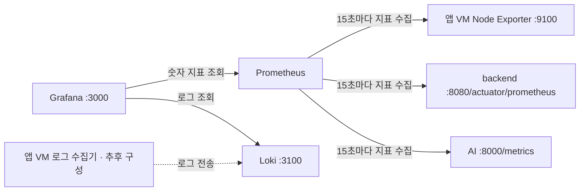

# 스테이징 모니터링 구성과 용어 설명

이 문서는 `/home/monitoring`에서 Prometheus·Loki·Grafana를 Docker Compose로 실행하는 스테이징 구성을 설명한다. 설정 파일 전체와 각 항목의 목적, 수집·조회 경로, Loki 저장소 용어, 적용 후 확인 방법을 함께 정리한다.

기준 이미지 버전은 Prometheus `v3.5.0`, Loki `3.7.0`, Grafana `12.4.0`이다. 구성값은 사용자가 제공한 예시를 기준으로 하며, 문서 작성 자체가 VM의 파일이나 실행 상태를 변경하지는 않는다.

## 1. 각 서비스가 맡는 역할

| 구성 요소 | 하는 일 | 예시 |
| --- | --- | --- |
| Node Exporter | VM 운영체제의 숫자 지표 제공 | CPU 사용 시간, 메모리, 디스크 여유 |
| 애플리케이션 메트릭 엔드포인트 | 앱 내부의 숫자 지표 제공 | HTTP 요청 수, JVM 상태, 처리 시간 |
| Prometheus | 지표를 주기적으로 가져와 시간과 함께 저장하고 조회 | 최근 5분 CPU 사용률 조회 |
| 로그 수집기 | 앱 로그를 읽고 Loki로 전송 | Alloy 등. 현재 제공된 Compose에는 없음 |
| Loki | 전달받은 로그와 검색용 인덱스를 저장하고 조회 | backend의 특정 시간대 오류 로그 조회 |
| Grafana | Prometheus·Loki에 질의하고 결과를 화면으로 표시 | 대시보드, Explore |

**현재 설정은 메트릭 수집을 구성하고 Loki 서버를 준비하는 단계다.** Loki를 실행하고 데이터소스를 등록해도 앱 로그가 자동으로 전송되지는 않는다. 앱 VM에 로그 수집 경로를 추가해야 실제 로그가 들어온다. [Loki 로그 전송 문서](https://grafana.com/docs/loki/latest/send-data/)



화살표는 요청을 시작하는 쪽을 기준으로 표시했다. Prometheus는 대상에게 지표를 요청하고, 로그 수집기는 Loki로 로그를 보낸다.

브라우저 접속은 별도 경로를 사용한다.

```text
https://grafana.mulostudio.p-e.kr
  → 외부 HTTPS LB → 모니터링 비관리형 인스턴스 그룹 → 10.21.0.2:3000

https://prometheus.mulostudio.p-e.kr
  → 같은 외부 HTTPS LB → 같은 인스턴스 그룹 → 10.21.0.2:9090
```

모니터링 그룹에는 기존 VM 한 대를 등록한다. 앱 MIG의 롤링 배포로 모니터링 VM이 교체되는 구성은 아니다. 이 경로를 사용하려면 Terraform 적용, DNS 연결, 인증서 발급 및 백엔드 정상 응답이 완료되어야 한다.

## 2. 파일 배치와 환경변수

```text
/home/monitoring/
├── .env
├── docker-compose.yaml
├── datasource.yaml
├── prometheus.yaml
└── loki-config.yaml
```

모든 파일명은 Compose의 마운트 경로와 대소문자까지 일치시킨다. 설정 파일의 위치인 `/home/monitoring`과 Docker가 실제 데이터를 보관하는 볼륨의 위치는 서로 다르다.

`.env`에는 다음 값을 설정한다. 기존 관리자 비밀번호가 있다면 유지한다. 아래 비밀번호는 실제 값으로 바꿔야 하는 예시다.

```dotenv
# /home/monitoring/.env
MONITORING_PRIVATE_IP=10.21.0.2
MONITORING_DOMAIN=mulostudio.p-e.kr
GRAFANA_ADMIN_PASSWORD='REPLACE_WITH_YOUR_PASSWORD'
```

| 변수 | 의미 |
| --- | --- |
| `MONITORING_PRIVATE_IP` | 컨테이너 포트를 공개할 VM의 내부 IP |
| `MONITORING_DOMAIN` | 서비스 이름을 제외한 기본 도메인 |
| `GRAFANA_ADMIN_PASSWORD` | Grafana 최초 관리자 생성 시 사용할 비밀번호 |

`${VAR:?message}`는 변수가 없거나 빈 문자열이면 Compose 실행을 오류로 중단한다. 예를 들어 `MONITORING_DOMAIN`이 설정되어 있으면 `grafana.${MONITORING_DOMAIN}`은 `grafana.mulostudio.p-e.kr`이 된다.

이 치환은 Docker Compose가 자신의 설정에 수행한다. 마운트한 `prometheus.yaml`의 GCE 필터를 자동으로 staging에서 prod로 바꿔주지는 않는다. [Compose 변수 치환 문서](https://docs.docker.com/compose/how-tos/environment-variables/variable-interpolation/)

## 3. Grafana 데이터소스: datasource.yaml

데이터소스는 “Grafana가 어디에 무엇을 질의할지”를 정하는 연결 정보다. 이 파일을 Grafana의 프로비저닝 디렉터리에 연결하면 시작 시 설정을 읽어 데이터소스를 등록한다. [Grafana 프로비저닝 문서](https://grafana.com/docs/grafana/latest/administration/provisioning/#data-sources)

```yaml
# /home/monitoring/datasource.yaml
apiVersion: 1 # Grafana 프로비저닝 파일의 설정 형식 버전

datasources:
  - name: Prometheus # Grafana 화면에 표시할 이름
    type: prometheus # 숫자 지표 조회용 데이터소스
    access: proxy # Grafana 서버가 Prometheus에 요청
    url: http://prometheus:9090 # 같은 Compose 네트워크의 서비스 이름과 포트
    isDefault: true # 기본 데이터소스로 지정

  - name: Loki
    type: loki # 로그 조회용 데이터소스
    access: proxy # Grafana 서버가 Loki에 요청
    url: http://loki:3100 # 같은 Compose 네트워크의 서비스 이름과 포트
```

브라우저는 외부 도메인으로 Grafana에 접속하고, Grafana는 내부 서비스 이름으로 Prometheus·Loki에 접속한다. 따라서 데이터소스 URL을 외부 LB 도메인으로 바꿀 필요가 없다.

`prometheus`와 `loki`는 Docker Compose의 서비스 이름이다. 같은 Compose 네트워크에서 이름으로 연결하므로 컨테이너 IP를 직접 적지 않아도 된다. [Compose 네트워크 문서](https://docs.docker.com/compose/how-tos/networking/)

## 4. 메트릭 수집: prometheus.yaml

### 4.1 전체 설정

```yaml
# /home/monitoring/prometheus.yaml
global:
  scrape_interval: 15s # 기본 메트릭 수집 주기

scrape_configs:
  # Prometheus 자체의 상태·성능 지표 수집
  - job_name: prometheus
    static_configs:
      - targets: ["prometheus:9090"] # 고정 대상. 기본 경로는 /metrics

  # 앱 VM의 CPU·메모리·디스크 등 운영체제 지표 수집
  - job_name: app-vm
    gce_sd_configs: # GCE API로 대상 VM 자동 탐색
      - project: project-7b071b48-8637-467a-80d
        zone: asia-northeast3-a
        port: 9100 # VM 내부 IP의 Node Exporter 포트
        refresh_interval: 30s # VM 목록 갱신 주기
        filter: '(labels.environment = staging) (status = RUNNING)'
    relabel_configs:
      # 지정한 네 서비스의 VM만 수집 대상으로 유지
      - source_labels: [__meta_gce_label_service]
        regex: 'frontend|backend|ai|chat'
        action: keep
      # VM의 service 라벨을 수집 지표의 service 라벨로 복사
      - source_labels: [__meta_gce_label_service]
        target_label: service
      # 기본 IP:포트 대신 VM 이름을 instance 라벨에 기록
      - source_labels: [__meta_gce_instance_name]
        target_label: instance

  # backend 애플리케이션 지표 수집
  - job_name: backend-app
    metrics_path: /actuator/prometheus # 앱이 제공해야 하는 지표 경로
    gce_sd_configs:
      - project: project-7b071b48-8637-467a-80d
        zone: asia-northeast3-a
        port: 8080 # backend 앱 포트
        refresh_interval: 30s
        filter: '(labels.environment = staging) (labels.service = backend) (status = RUNNING)'
    relabel_configs:
      - source_labels: [__meta_gce_instance_name]
        target_label: instance # 지표가 어느 VM에서 왔는지 기록

  # AI 애플리케이션 지표 수집
  - job_name: ai-app
    metrics_path: /metrics
    gce_sd_configs:
      - project: project-7b071b48-8637-467a-80d
        zone: asia-northeast3-a
        port: 8000 # AI 앱 포트
        refresh_interval: 30s
        filter: '(labels.environment = staging) (labels.service = ai) (status = RUNNING)'
    relabel_configs:
      - source_labels: [__meta_gce_instance_name]
        target_label: instance # AI VM이 여러 대일 때 VM 이름으로 구분
```

### 4.2 MIG 롤링 배포와 자동 탐색

MIG 롤링 배포는 새 VM을 생성하고 기존 VM을 교체할 수 있다. 새 VM의 IP가 달라지므로 수집 대상을 `10.x.x.x:9100`처럼 고정하면 배포마다 설정을 수정해야 한다.

이 구성에서는 GCE API로 실행 중인 staging VM을 찾고, 서비스 라벨로 대상을 선별한다. 새 VM에도 동일한 환경·서비스 라벨과 필요한 메트릭 서비스가 있으면 다음 탐색 주기에 대상에 반영된다. `RUNNING`은 VM 전원 상태이며 애플리케이션 준비 완료를 뜻하지 않는다.

### 4.3 탐색 주기와 수집 주기

| 설정 | 질문 | 현재 값 |
| --- | --- | --- |
| `refresh_interval` | 지금 수집할 VM이 누구인지 얼마나 자주 다시 찾는가? | 30초 |
| `scrape_interval` | 발견한 대상에게 얼마나 자주 지표를 요청하는가? | 15초 |
| `metrics_path` | 대상의 어느 HTTP 경로로 요청하는가? | 앱별 지정, 미지정 시 `/metrics` |

예를 들어 `10.21.0.10`의 backend VM을 발견하면 시스템 지표는 `:9100/metrics`, 앱 지표는 `:8080/actuator/prometheus`에서 각각 수집한다.

### 4.4 relabel_configs가 하는 일

`__meta_gce_label_service`와 `__meta_gce_instance_name`은 탐색 중 얻은 임시 메타데이터다. 필요한 값을 `service`·`instance` 같은 일반 라벨로 복사해 이후 쿼리에서 사용한다.

| 탐색 정보 | 처리 결과 예시 |
| --- | --- |
| VM 라벨 `service=backend` | `app-vm` 작업의 지표에 `service="backend"` 부여 |
| VM 이름 `mulo-v2-staging-backend-abcd` | `instance="mulo-v2-staging-backend-abcd"` 부여 |
| VM 라벨 `service=monitoring` | `app-vm`의 keep 조건과 다르므로 제외 |

이 설정에서 `service` 복사는 `app-vm` 작업에만 있다. `backend-app`·`ai-app`은 `job`과 `instance`로 구분할 수 있고, 동일한 `service` 라벨이 필요하면 각 작업에도 별도 복사 규칙을 추가해야 한다.

GCE 탐색과 relabel 동작의 근거는 [Prometheus GCE 설정 문서](https://prometheus.io/docs/prometheus/latest/configuration/configuration/#gce_sd_config)다.

### 4.5 수집이 되기 위한 조건

GCE API로 VM 목록을 조회할 인증·권한, Node Exporter 설치, 앱의 지표 엔드포인트, 모니터링 VM에서 대상 포트로 가는 네트워크 경로가 필요하다. 자동 탐색 설정은 exporter나 앱의 메트릭 기능을 설치하지 않는다.

이 저장소의 모니터링 서비스 계정에는 로그·메트릭 쓰기 권한이 명시되어 있다. GCE 읽기 권한은 실제 IAM에서 추가 부여되었는지 확인해야 한다. `roles/compute.viewer`는 읽기 권한을 제공하는 사전 정의 역할의 한 예다. 이 문서는 IAM을 변경하지 않는다. [Compute Engine IAM 역할 문서](https://docs.cloud.google.com/compute/docs/access/iam#compute.viewer)

## 5. 로그 저장 설정: loki-config.yaml

### 5.1 먼저 바로잡은 부분

입력에 경로가 두 번 들어간 항목이 있었다.

```text
/loki/chunks /loki/chunks
/loki/rules  /loki/rules
```

YAML은 이를 두 경로로 해석하지 않고 공백이 포함된 하나의 문자열로 읽을 수 있다. 문서에서는 각각 `/loki/chunks`와 `/loki/rules`로 바로잡았다.

아래 `from: "2026-10-14"`는 **이 날짜 이전의 기존 로그가 없는 신규 설치 예시**다. 기존 설치에서 `from: 2024-01-01` 등 다른 값을 사용해 데이터를 저장했다면 기존 항목을 유지한다. 도메인 연결이나 주석 추가를 이유로 이 날짜를 변경할 필요는 없다.

### 5.2 전체 설정

```yaml
# /home/monitoring/loki-config.yaml
auth_enabled: false # 단일 테넌트 모드. 사용자 로그인 기능 설정과는 별개

server:
  http_listen_port: 3100 # 로그 전송·조회 HTTP API 포트

common:
  instance_addr: 127.0.0.1 # 단일 인스턴스가 링에 알릴 주소. HTTP 바인딩 주소와 별개
  path_prefix: /loki # 여러 Loki 데이터 경로의 기준 디렉터리
  storage:
    filesystem:
      chunks_directory: /loki/chunks # 압축한 로그 묶음인 청크 저장 경로
      rules_directory: /loki/rules # Ruler에서 사용할 규칙 저장 경로
  replication_factor: 1 # 데이터 복제본 수 1개
  ring:
    kvstore:
      store: inmemory # 링의 참여 인스턴스 정보를 프로세스 메모리에 보관

schema_config:
  configs:
    - from: "2026-10-14" # UTC 00:00부터 적용. 기존 데이터가 있다면 기존 날짜 유지
      store: tsdb # 로그 검색용 인덱스의 저장 방식
      object_store: filesystem # 청크·저장된 인덱스에 사용할 저장소 종류
      schema: v13 # 데이터를 쓰고 읽는 저장 형식 버전
      index:
        prefix: index_ # 인덱스 테이블 이름의 접두사
        period: 24h # 인덱스 기간. 이 TSDB 구성은 24시간 단위를 사용

limits_config:
  retention_period: 168h # 로그 보관기간 7일

compactor:
  working_directory: /loki/compactor # 인덱스 작업 파일·삭제 대기 마커를 보관
  retention_enabled: true # 보관기간이 지난 로그의 정리 활성화
  delete_request_store: filesystem # 삭제 API 요청과 처리 상태를 저장할 저장소 종류
```

`auth_enabled: false`이면 모든 로그가 하나의 테넌트를 사용한다. 테넌트는 데이터를 분리하는 논리적 공간이다. 이 옵션을 `true`로 바꾸는 것만으로 사용자 로그인이나 비밀번호 인증이 생기지는 않는다. [Loki 테넌시 문서](https://grafana.com/docs/loki/latest/operations/multi-tenancy/)

## 6. 컨테이너 실행: docker-compose.yaml

```yaml
# /home/monitoring/docker-compose.yaml
services:
  prometheus:
    image: prom/prometheus:v3.5.0 # 사용할 소프트웨어 버전
    restart: unless-stopped # 직접 중지한 경우를 제외하고 자동 재시작
    command:
      - --config.file=/etc/prometheus/prometheus.yaml # 수집 설정 파일
      - --storage.tsdb.path=/prometheus # 숫자 지표 저장 경로
      - --storage.tsdb.retention.time=7d # 숫자 지표 보관기간
      - --web.listen-address=0.0.0.0:9090 # 컨테이너 내부 HTTP 수신 주소
      - --web.external-url=https://prometheus.${MONITORING_DOMAIN:?set MONITORING_DOMAIN in .env} # 외부 URL
    ports:
      # VM 내부 IP:VM 포트:컨테이너 포트. LB는 VM의 9090 포트에 연결
      - "${MONITORING_PRIVATE_IP:?set MONITORING_PRIVATE_IP in .env}:9090:9090"
    volumes:
      - ./prometheus.yaml:/etc/prometheus/prometheus.yaml:ro # 설정 파일 읽기 전용 연결
      - prometheus-data:/prometheus # 숫자 지표를 Docker 볼륨에 보관

  loki:
    image: grafana/loki:3.7.0
    restart: unless-stopped
    command:
      - -config.file=/etc/loki/local-config.yaml # Loki 설정 파일
    ports:
      # 앱 VM의 로그 수집기가 내부 네트워크로 전송할 포트
      - "${MONITORING_PRIVATE_IP:?set MONITORING_PRIVATE_IP in .env}:3100:3100"
    volumes:
      - ./loki-config.yaml:/etc/loki/local-config.yaml:ro
      - loki-data:/loki # 청크와 Loki 작업 상태를 VM 디스크의 볼륨에 보관

  grafana:
    image: grafana/grafana:12.4.0
    restart: unless-stopped
    depends_on:
      # 시작 순서만 지정. Prometheus·Loki의 준비 완료까지 기다리지는 않음
      - prometheus
      - loki
    environment:
      GF_SECURITY_ADMIN_USER: admin # 최초 관리자 계정 이름
      GF_SECURITY_ADMIN_PASSWORD: "${GRAFANA_ADMIN_PASSWORD:?set GRAFANA_ADMIN_PASSWORD in .env}"
      GF_SERVER_DOMAIN: "grafana.${MONITORING_DOMAIN:?set MONITORING_DOMAIN in .env}"
      GF_SERVER_ROOT_URL: "https://grafana.${MONITORING_DOMAIN:?set MONITORING_DOMAIN in .env}/" # 링크·리다이렉트 기준 URL
      GF_SERVER_PROTOCOL: http # 외부 HTTPS는 LB에서 종료
      GF_SECURITY_COOKIE_SECURE: "true" # 로그인 쿠키는 HTTPS 요청에서만 전송
    ports:
      # LB는 VM 내부 IP의 3000 포트에 연결
      - "${MONITORING_PRIVATE_IP:?set MONITORING_PRIVATE_IP in .env}:3000:3000"
    volumes:
      - ./datasource.yaml:/etc/grafana/provisioning/datasources/datasources.yml:ro
      - grafana-data:/var/lib/grafana # 사용자·대시보드·설정 보관

volumes:
  prometheus-data: # 숫자 지표
  loki-data: # 로그와 Loki 저장 상태
  grafana-data: # Grafana 사용자·대시보드·설정
```

### 6.1 내부 IP 바인딩과 외부 URL

`127.0.0.1:3000:3000`은 VM 자기 자신에서만 접근하는 바인딩이다. LB가 VM 내부 IP로 접근하려면 `10.21.0.2:3000:3000`처럼 내부 IP에 포트를 열어야 한다.

`--web.listen-address=0.0.0.0:9090`은 **컨테이너 안의** 수신 주소다. `ports`의 IP는 **VM의** 수신 주소다. 둘은 다른 네트워크 공간의 설정이다.

TLS는 LB에서 처리하므로 Grafana 컨테이너는 HTTP를 사용하고, 링크·리다이렉트 기준인 `GF_SERVER_ROOT_URL`은 외부 HTTPS 주소로 설정한다. Prometheus의 `--web.external-url`도 외부 주소로 지정한다. [Grafana 프록시 문서](https://grafana.com/tutorials/run-grafana-behind-a-proxy/), [Prometheus 실행 옵션 문서](https://prometheus.io/docs/prometheus/latest/command-line/prometheus/)

### 6.2 설정 파일과 영속 볼륨

`./loki-config.yaml:/etc/loki/local-config.yaml:ro`는 VM의 설정 파일을 컨테이너에 읽기 전용으로 연결하는 **bind mount**다. `ro`는 read only의 약자다.

`loki-data:/loki`는 Docker가 관리하는 **named volume**을 컨테이너의 `/loki`에 연결한다. 컨테이너를 재생성해도 같은 볼륨을 연결하면 저장된 데이터를 다시 사용할 수 있다. 실제 볼륨 이름에는 Compose 프로젝트 접두사가 붙을 수 있으므로 기존 디렉터리·프로젝트 이름을 유지한다.

| 컨테이너 안의 경로 | 저장되는 내용 | 영속 볼륨 |
| --- | --- | --- |
| `/prometheus` | Prometheus 숫자 지표 | `prometheus-data` |
| `/loki/chunks` | Loki 로그 청크와 파일시스템 저장소 데이터 | `loki-data`의 일부 |
| `/loki/rules` | Ruler 규칙 | `loki-data`의 일부 |
| `/loki/compactor` | Compactor 작업 상태·삭제 대기 마커 | `loki-data`의 일부 |
| `/var/lib/grafana` | Grafana 사용자·대시보드 등 | `grafana-data` |

볼륨은 컨테이너 재생성에 대비하는 저장 방식이다. VM 디스크 손실까지 복구하는 백업은 별도로 마련해야 한다. [Docker 볼륨 문서](https://docs.docker.com/engine/storage/volumes/)

## 7. 용어를 데이터 흐름에 따라 이해하기

### 7.1 메트릭, 시계열, 스크레이프, Exporter

**메트릭(metric)**은 측정한 숫자다. 예를 들어 남은 메모리 바이트 수나 HTTP 요청 수가 있다.

**시계열(time series)**은 같은 측정 대상의 숫자를 시간순으로 모은 것이다. “backend VM의 남은 메모리가 10:00에는 1.2GB, 10:01에는 1.1GB”처럼 값과 시간이 연결된다.

**스크레이프(scrape)**는 Prometheus가 HTTP 요청으로 지표를 가져오는 작업이다. **Exporter**는 다른 시스템의 상태를 Prometheus가 읽을 수 있는 형태로 내보내는 프로그램이다. Node Exporter는 VM 운영체제 지표를 제공한다. [Prometheus Node Exporter 안내](https://prometheus.io/docs/guides/node-exporter/)

### 7.2 라벨, 스트림, 청크, 인덱스

**라벨(label)**은 데이터를 구분하는 이름표다. Loki에서 정확히 같은 라벨 집합을 가진 로그의 연속을 **스트림(stream)**이라고 한다.

다음은 로그 수집기가 구성된 뒤를 가정한 예시다. 현재 Compose가 이 로그를 자동으로 생성하거나 전송하지는 않는다.

```text
라벨: {environment="staging", service="backend", instance="backend-abcd"}

10:00:01 INFO  request completed
10:00:02 ERROR database timeout
10:00:03 INFO  request completed
```

이 스트림의 로그 여러 줄을 모아 압축한 저장 단위가 **청크(chunk)**다. “여러 로그 줄을 담은 압축 묶음”으로 이해하면 된다. 청크 하나가 로그 한 줄이나 하루 전체 로그를 뜻하지는 않는다.

**인덱스(index)**는 원하는 로그가 들어 있는 청크를 찾기 위한 검색용 정보다. Loki는 라벨을 중심으로 인덱스를 구성하고, 로그 본문은 청크에 저장한다. [Loki 저장소 설명](https://grafana.com/docs/loki/latest/configure/storage/)

| 개념 | 위 예시에서의 의미 |
| --- | --- |
| 라벨 | 환경·서비스·VM 이름표 |
| 스트림 | 같은 이름표를 가진 backend 로그의 연속 |
| 청크 | 그 로그들을 모아 압축한 묶음 |
| 인덱스 | 어느 라벨·시간 범위의 청크를 찾아야 하는지 안내하는 정보 |

예를 들어 `{service="backend"} |= "ERROR"`를 조회하면 라벨과 시간 범위로 대상 청크를 좁힌 뒤 해당 청크의 로그 본문에서 `ERROR`를 찾는다.

청크는 크기와 시간 등의 조건에 따라 저장된다. 따라서 `index.period: 24h`를 “청크 하나에 24시간 로그를 담는다”로 해석하면 안 된다. [Loki 청크 설정 설명](https://grafana.com/docs/loki/latest/configure/bp-configure/#use-chunk_target_size)

#### 7.2.1 같은 스트림에서 청크가 여러 개 만들어지는 이유

같은 테넌트에서 동일한 전체 라벨 집합을 가진 로그는 같은 스트림에 속한다. 해당 스트림의 로그가 계속 들어오면 여러 청크에 걸쳐 저장된다. 내부 식별에 해시를 사용한다는 설명보다 문서에서는 전체 라벨 집합을 스트림의 구분 기준으로 설명하는 편이 명확하다.

```text
{environment="staging", service="backend"}
  └─ backend 스트림
       ├─ 청크 A: 앞서 수신한 로그 묶음
       ├─ 청크 B: 다음에 수신한 로그 묶음
       └─ 청크 C: 현재 작성 중인 로그 묶음

{environment="staging", service="ai"}
  └─ 별도의 AI 스트림
       └─ 청크 D
```

라벨 키·값의 추가, 제거, 변경으로 전체 집합이 달라지면 다른 스트림에 속한다. 이전에 이미 존재했던 라벨 집합으로 돌아온 로그는 해당 스트림으로 분류된다. 로그 본문의 문자열만 바뀌고 라벨은 같다면 같은 스트림이다. [Loki 라벨 문서](https://grafana.com/docs/loki/latest/get-started/labels/)

#### 7.2.2 청크가 저장되는 조건

Ingester는 수신한 로그를 스트림별로 모으며 청크를 관리한다. 청크는 목표 크기, 최대 유지 시간, 새 로그가 들어오지 않은 시간 같은 조건에 따라 닫혀 저장소로 전송될 수 있다. 이 저장소 전송 과정을 플러시(flush)라고 한다. 현재 구성에서는 파일시스템 저장소로 전송한다.

따라서 로그 발생량이 적어 목표 크기에 못 미친 청크도 시간 조건에 따라 저장될 수 있다. 로그는 청크 내부 블록 단위로 압축될 수 있으므로 “청크 전체가 꽉 찬 다음에만 압축을 시작한다”는 설명도 피한다. [Loki 청크 설정 문서](https://grafana.com/docs/loki/latest/configure/bp-configure/), [Loki 저장 구조](https://grafana.com/docs/loki/latest/get-started/architecture/)

#### 7.2.3 로그를 찾는 과정

최근 10분을 시간 범위로 선택하고 `{service="backend"} |= "ERROR"`를 실행하는 예시다.

1. `service="backend"`와 조회 시간 범위로 관련 스트림·청크를 찾는다.
2. 해당 로그 데이터를 읽는다.
3. 로그 본문에 `ERROR`가 포함된 줄을 필터링한다.
4. 결과를 Grafana에 표시한다.

최근 로그는 Ingester 메모리에 남아 있을 수 있어 저장소 데이터와 함께 조회될 수 있다. 위 단계는 이해를 위한 개념적 흐름이며 모든 조회가 디스크의 모든 청크를 읽는다는 뜻은 아니다. [Loki 조회 구조](https://grafana.com/docs/loki/latest/get-started/architecture/)

#### 7.2.4 라벨 개수가 저장 효율에 미치는 영향

카디널리티(cardinality)는 여기서 고유한 라벨 조합의 수를 뜻한다. `request_id`처럼 매 요청마다 바뀌는 값을 라벨로 넣으면 스트림이 잘게 나뉘고 작은 청크와 인덱스가 많아져 저장·조회 부담이 커진다.

| 데이터 | 저장 위치를 정하는 기준 |
| --- | --- |
| 환경·서비스처럼 값의 종류가 제한된 구분값 | 검색에 필요한 인덱스 라벨 후보 |
| 요청 ID처럼 거의 매번 바뀌는 값 | 로그 본문이나 구조화 메타데이터에 보관 |

구조화 메타데이터는 로그 한 줄에 연결하는 부가 정보로, 해당 값을 인덱스 라벨로 만들어 스트림을 나누지 않고 기록할 수 있다. [Loki 카디널리티 문서](https://grafana.com/docs/loki/latest/get-started/labels/cardinality/)

#### 7.2.5 현재 설정에서 라벨을 붙이는 위치

현재 `loki-config.yaml`은 저장소·링·보관기간을 설정한다. 앱 로그를 읽고 `environment`·`service` 라벨을 붙이는 작업은 Alloy 같은 로그 수집 경로에서 별도로 구성해야 한다. Prometheus의 GCE 탐색·relabel 설정이 Loki 로그 라벨을 자동으로 만들어주지는 않는다. 로그 수집 경로를 추가한 뒤 실제 전송된 라벨을 확인한다. [Loki 라벨 적용 설명](https://grafana.com/docs/loki/latest/get-started/labels/#loki-labels-examples)

### 7.3 TSDB란 무엇인가?

TSDB는 **Time Series Database**, 즉 시계열 데이터베이스의 약자다.

| 사용 위치 | 이 문서에서의 의미 |
| --- | --- |
| Prometheus의 `--storage.tsdb.path` | 시간에 따라 수집한 숫자 지표를 저장하는 경로 |
| Loki의 `store: tsdb` | 로그의 라벨·시간 범위·청크 참조 등을 관리하는 인덱스 방식 |

Loki가 Prometheus와 같은 DB 프로세스에 로그를 넣는다는 의미는 아니다. Loki TSDB 인덱스는 Prometheus TSDB 설계의 영향을 받은 별도 구현이다. 로그 본문은 여전히 청크로 저장한다. [Loki TSDB 문서](https://grafana.com/docs/loki/latest/operations/storage/tsdb/), [Prometheus 저장소 문서](https://prometheus.io/docs/prometheus/latest/storage/)

`store: tsdb`는 **인덱스를 어떤 방식으로 구성할지**, `object_store: filesystem`은 **저장된 데이터를 어떤 종류의 저장소에 둘지**를 정한다. 현재는 파일시스템을 사용하며 별도 GCS 버킷에 저장하는 구성은 아니다.

### 7.4 Ruler란 무엇인가?

**Ruler**는 Loki 쿼리로 작성한 규칙을 정기적으로 계산하는 구성 요소다. 대표적으로 두 종류를 처리한다.

| 규칙 | 하는 일 | 예시 |
| --- | --- | --- |
| Alerting rule | 조건이 성립하는지 평가해 알림 상태 생성 | 최근 5분 backend ERROR가 20건 초과 |
| Recording rule | 반복 계산 결과를 숫자 시계열로 만들어 저장 대상으로 전송 | 서비스별 분당 오류 수를 미리 계산 |

Ruler의 알림 전달에는 Alertmanager 등 추가 연결이 필요하고, recording rule의 결과 저장에도 remote write 대상 같은 설정이 필요하다. `rules_directory: /loki/rules`는 규칙을 둘 저장 경로다. 디렉터리만 지정했다고 규칙이나 알림 수신처가 생성되지는 않는다.

Grafana에서 별도로 만드는 Grafana 관리 알림과 Loki Ruler 규칙은 관리 주체가 다르다. 현재 파일에는 사용자가 정의한 Ruler 규칙이 없다. [Loki 규칙 문서](https://grafana.com/docs/loki/latest/alert/)

### 7.5 링(ring)이란 무엇인가?

**링**은 Loki의 같은 종류 구성 요소들이 서로의 ID·주소·상태를 알아보고 작업 담당을 결정할 때 사용하는 정보 구조다. 물리적인 원형 네트워크를 만드는 설정은 아니다.

여러 Ingester가 있다면 스트림을 어느 Ingester에 보낼지 결정하는 데 일관된 해싱(consistent hashing)을 사용한다. Ingester는 들어온 로그를 받아 청크로 모으는 구성 요소다.

현재 설정은 다음처럼 단순하다.

| 항목 | 현재 의미 |
| --- | --- |
| Loki 컨테이너 1개 | 처리할 인스턴스가 하나 |
| `instance_addr: 127.0.0.1` | 내부 구성 요소가 링을 통해 알릴 인스턴스 주소 |
| `replication_factor: 1` | 데이터 복제본 한 개 |
| `store: inmemory` | 링 정보를 현재 프로세스 메모리에 보관 |

`inmemory`는 **로그를 메모리에만 저장한다는 뜻이 아니다.** 로그 파일은 파일시스템과 Docker 볼륨에 저장한다. 또한 `instance_addr`는 HTTP API의 접근 범위를 제한하는 바인딩 주소가 아니다. 여러 Loki 인스턴스로 확장할 때는 다른 인스턴스가 접근할 주소와 공유할 링 구성을 다시 설계해야 한다. [Loki 링 문서](https://grafana.com/docs/loki/latest/get-started/hash-rings/), [Loki 설정 참조](https://grafana.com/docs/loki/latest/configure/#common)

### 7.6 저장 스키마 버전은 왜 중요한가?

**저장 스키마(schema)**는 저장할 데이터를 어떤 규칙과 형식으로 쓰고, 나중에 어떻게 해석할지 정한 약속이다. Loki는 조회할 시간대에 적용되는 스키마를 찾아 해당 형식으로 데이터를 읽는다.

| 값 | 버전의 대상 |
| --- | --- |
| `image: grafana/loki:3.7.0` | Loki 프로그램 |
| `schema: v13` | Loki 데이터 저장 형식 |
| `apiVersion: 1` | Grafana 데이터소스 설정 파일 형식 |

프로그램 버전과 저장 형식 버전은 서로 독립적이다. 현재 Loki 구성에서 사용하는 구조화 메타데이터 같은 기능은 TSDB·v13 이상의 저장 형식이 필요하다.

`from: "2026-10-14"`는 `2026-10-14 00:00 UTC`, 한국 시각으로 오전 9시부터 적용한다. 신규 설치는 적용 시점보다 과거 날짜를 사용한다. 기존 설치의 형식을 바꿀 때는 과거 항목을 보존하고 미래 날짜의 항목을 추가해 전환한다. 과거 항목을 덮어쓰면 이미 저장한 로그의 형식을 잘못 해석하거나 해당 기간을 조회하지 못할 수 있다. [Loki 스키마 문서](https://grafana.com/docs/loki/latest/operations/storage/schema/)

### 7.7 TSDB 인덱스에 왜 24시간이 필요한가?

`index.period: 24h`는 **인덱스를 나누는 시간 구간**이다. 이 Loki TSDB 구성은 일 단위 인덱스 테이블을 사용한다. Compactor는 날짜·테넌트 단위로 인덱스를 정리하고, 보관기간이 지난 청크 참조를 제거한다.

공식적으로 지원하는 이 저장·정리 경로의 인덱스 기간이 `24h`이므로 그 값을 맞춘다. 모든 시계열 DB가 원리상 24시간을 요구하는 것은 아니다. [Loki 보관기간 문서](https://grafana.com/docs/loki/latest/operations/storage/retention/#retention-configuration)

Loki 3.7.0의 설정 검사 코드도 TSDB 인덱스 기간을 24시간으로 제한한다. 보관기간 정리를 사용하지 않더라도 이 TSDB 설정에서 지켜야 하는 조건이다. [Loki 3.7.0 스키마 검사 코드](https://github.com/grafana/loki/blob/v3.7.0/pkg/storage/config/schema_config.go)

| 설정 | 역할 | 값 |
| --- | --- | --- |
| `scrape_interval` | Prometheus 지표 수집 주기 | 15초 |
| `index.period` | Loki 인덱스 구간 | 24시간 |
| `retention_period` | Loki 로그 보관기간 | 168시간 |
| `--storage.tsdb.retention.time` | Prometheus 지표 보관기간 | 7일 |

`24h`는 로그 보관기간도, 정리 작업의 실행 주기도, 청크 하나의 길이도 아니다.

### 7.8 Compactor와 “인덱스 압축·정리 작업용 경로”

**Compactor**는 흩어진 인덱스 파일을 합쳐 조회하기 좋게 정리하는 구성 요소다. 여기서 압축(compaction)은 여러 인덱스 파일의 병합·재구성을 가리킨다. 로그 본문을 gzip 같은 방식으로 압축해 청크를 만드는 작업과 구분한다.

개념적인 예시:

```text
같은 날짜·테넌트의 작은 인덱스 A, B, C
  → 파일을 작업 디렉터리로 내려받음
  → 정보를 병합·정리한 인덱스 생성
  → 저장소에 새 인덱스 반영
```

`working_directory: /loki/compactor`는 이 작업을 수행할 **작업대 경로**다. 인덱스 작업 파일을 둘 공간이 필요하다. Compactor는 보관기간에 따른 삭제 처리도 담당한다. [Loki 구성 요소 문서](https://grafana.com/docs/loki/latest/get-started/components/#compactor)

보관기간 정리는 대략 다음 순서로 이해할 수 있다.

1. 만료된 청크를 가리키는 참조를 인덱스에서 제거한다.
2. 나중에 삭제할 청크를 마커 파일에 기록한다.
3. 수정한 인덱스를 반영한다.
4. 별도 정리 작업이 대기 시간 후 실제 청크를 삭제한다.

인덱스를 먼저 수정하고 파일 삭제를 늦추는 이유는 이전 인덱스를 사용 중인 조회 과정이 이미 삭제된 청크를 참조하지 않도록 하기 위해서다. 삭제는 `168h`가 되는 순간 일괄 완료되는 방식이 아니다.

작업 디렉터리에는 삭제 대기 마커처럼 재시작 후에도 필요한 상태가 들어갈 수 있다. 따라서 단순 임시 폴더로 보고 비우면 안 된다. 현재는 `loki-data:/loki` 아래에 있어 볼륨에 보관된다. [Loki 삭제 마커 설명](https://grafana.com/docs/loki/latest/operations/storage/retention/#compactor)

### 7.9 삭제 요청 정보를 왜 파일시스템에 저장하는가?

`delete_request_store`는 **삭제 API로 접수한 요청과 처리 상태를 보관할 저장소 종류**다. 예를 들어 “특정 스트림의 특정 시간대 로그를 삭제해 달라”는 요청을 접수했다면 작업이 끝날 때까지 그 조건과 진행 상태를 기억해야 한다.

메모리에만 두면 프로세스 재시작 시 요청을 잃을 수 있다. 디스크 저장소에 기록하면 재시작 후에도 처리할 요청을 다시 읽을 수 있다.

`filesystem`은 이 단일 VM 구성에서 이미 쓰고 있는 파일시스템 저장소를 사용한다는 선택이다. 모든 배포가 파일시스템을 써야 하는 것은 아니며 다른 저장소를 선택할 수도 있다. 이 항목은 디렉터리 경로 자체가 아니다. [Loki 로그 삭제 문서](https://grafana.com/docs/loki/latest/operations/storage/logs-deletion/)

구분해야 할 상태는 다음과 같다.

| 구분 | 기록하는 것 | 용도 |
| --- | --- | --- |
| 삭제 요청 저장소 | API 삭제 요청의 조건·처리 상태 | 사용자가 요청한 삭제 관리 |
| 삭제 대기 마커 | 실제 파일 삭제를 기다리는 청크 참조 | 인덱스 수정 후 비동기 청크 삭제 |
| 청크 저장소 | 압축한 원본 로그 | 로그 본문 보관 |

`retention_period: 168h`에 따른 자동 만료와 삭제 API 요청은 서로 다른 입력이다. 자동 만료가 청크마다 사용자 API 요청을 생성한다고 이해하면 안 된다. 현재 Loki는 `retention_enabled: true`일 때 삭제 요청 저장소 설정도 요구한다. [Loki 보관기간 설정](https://grafana.com/docs/loki/latest/operations/storage/retention/#retention-configuration)

### 7.10 파일시스템 저장소와 Docker 볼륨은 같은 것인가?

서로 다른 층의 설정이다.

- `object_store: filesystem`: Loki가 파일을 읽고 쓰는 저장소 방식을 선택한다.
- `loki-data:/loki`: 그 파일이 저장되는 컨테이너 경로를 Docker 볼륨에 연결한다.

“Loki는 파일로 저장하고, Docker는 그 파일이 들어갈 지속적인 저장 공간을 연결한다”는 관계다. 로그가 7일 동안 무제한으로 쌓일 공간이 보장되는 것은 아니다. 파일시스템 저장소는 디스크 여유가 부족하다는 이유로 자동 정리를 앞당기지 않으므로 실제 사용량을 확인해야 한다. [Loki 파일시스템 저장소 문서](https://grafana.com/docs/loki/latest/operations/storage/filesystem/)

## 8. 적용과 확인

### 8.1 설정 파일 검증과 실행

기존 Compose 프로젝트 이름과 위치를 유지한 채 모니터링 VM에서 실행한다.

```bash
cd /home/monitoring

# Compose 문법과 필수 환경변수 검사
docker compose config --quiet

# Prometheus 설정 파일 자체 검사
docker compose run --rm --no-deps --entrypoint=promtool prometheus \
  check config /etc/prometheus/prometheus.yaml

# Loki 설정 검사
docker compose run --rm --no-deps loki \
  -config.file=/etc/loki/local-config.yaml -verify-config=true

# 변경된 Compose 설정 반영
docker compose up -d

# 컨테이너 상태 및 최근 로그 확인
docker compose ps
docker compose logs --tail=100 prometheus loki grafana
```

`config --quiet`는 Compose 파일을 검사한다. 마운트한 Prometheus·Loki 설정의 의미나 실제 GCE 권한까지 검증하지는 않는다. 위 도구별 검사와 실행 후 확인을 함께 한다.

### 8.2 VM 내부 IP로 상태 확인

```bash
curl -fsS http://10.21.0.2:3000/api/health
curl -fsS http://10.21.0.2:9090/-/ready
curl -fsS http://10.21.0.2:3100/ready
```

HTTP 정상 응답은 각 서비스의 해당 상태 확인 경로가 응답한다는 뜻이다. 앱 지표나 로그가 실제로 수집됐다는 의미는 아니다.

### 8.3 수집과 외부 접속 확인

| 확인할 것 | 확인 위치·방법 | 기대 결과 |
| --- | --- | --- |
| 앱 VM 탐색 | Prometheus의 Service Discovery 화면 | staging의 대상 VM 발견 |
| 지표 수집 | Prometheus Targets 화면 또는 `up` 쿼리 | 실행 중이고 준비된 대상의 `up=1` |
| Grafana 데이터소스 | Connections의 Prometheus·Loki 연결 테스트 | 각 내부 서비스에 연결 성공 |
| 앱 로그 | Grafana Explore에서 Loki 조회 | 로그 수집기를 추가한 뒤 실제 앱 로그 확인 |
| LB 백엔드 | 아래 `get-health` 명령 | Grafana·Prometheus 백엔드 정상 |
| 인증서·DNS | GCP 인증서 상태와 DNS 조회 | 인증서 `ACTIVE`, 도메인이 해당 LB IP로 연결 |
| 브라우저 | 두 HTTPS 도메인 접속 | Grafana 로그인 화면, Prometheus UI |

```bash
gcloud compute backend-services get-health mulo-v2-staging-grafana-service \
  --global --project=project-7b071b48-8637-467a-80d

gcloud compute backend-services get-health mulo-v2-staging-prometheus-service \
  --global --project=project-7b071b48-8637-467a-80d
```

DNS 등록값은 Terraform의 `environments/staging`에서 `terraform output -json monitoring_dns_records`로 확인한다. IaC 적용 절차는 [스테이징 환경 안내](../environments/staging/README.md#모니터링-도메인-접속)에 있다.

Prometheus 외부 UI·API의 사용자 인증은 이 Compose에 포함되어 있지 않다. Grafana 관리자 비밀번호는 Prometheus 접속을 보호하는 설정이 아니다.

## 9. 이 문서에서 확인한 범위

2026-10-15에 문서에서 예제를 추출해 다음 정적 검사를 완료했다.

| 검사 | 결과 |
| --- | --- |
| YAML 설정 파일 4개의 문법 파싱 | 통과 |
| staging 환경변수를 넣은 `docker compose config --quiet` | 통과 |
| Markdown 코드 블록 짝과 상대 경로 파일 링크 | 통과 |

이는 로컬 문서 예제의 정적 검사이며, Prometheus·Loki 프로그램 자체의 설정 검사, VM 컨테이너 기동·GCE 탐색·로그 수집·외부 HTTPS 접속의 성공을 대신하지 않는다. 실제 결과는 8절 절차로 확인한다.

prod에 재사용할 때는 `MONITORING_PRIVATE_IP=10.20.0.2`, `MONITORING_DOMAIN=mulostudio.com`으로 설정하고 Prometheus 필터 세 곳의 환경을 `prod`로 바꾼다. Loki에 기존 데이터가 있다면 스키마 이력은 해당 환경의 기존 설정을 보존한다.
