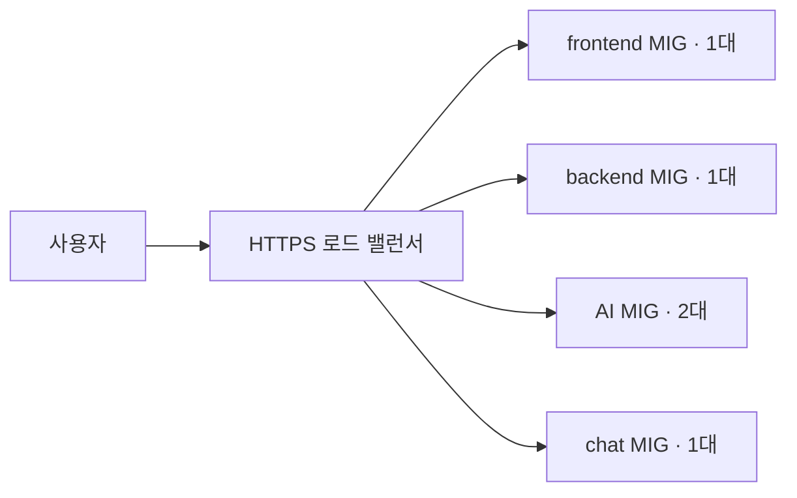

# 환경 공통 구성

[개발](dev/README.md) · [스테이징](staging/README.md) · [운영](prod/README.md) · [저장소 안내](../README.md)

## 환경 구분

| 항목 | 개발 | 스테이징 | 운영 |
| --- | --- | --- | --- |
| 기본 접두사 | `mulo-v2-dev` | `mulo-v2-staging` | `mulo-v2` |
| VPC | 기존 `default` 사용 | 전용 VPC 생성 | 별도 전용 VPC 생성 |
| VM 서브넷 | 기존 `default` 서브넷 | `10.21.0.0/24` | `10.20.0.0/24` |
| 앱 VM 주소 | 고정 공인·내부 IP | 내부 IP 자동 할당 | 내부 IP 자동 할당 |
| DB 접속 | 공인 IP와 TLS | 사설 IP | 사설 IP, 기존 DB는 TLS 유지 |
| 이미지 버킷 | 새 비공개 버킷 | 새 비공개 버킷 | 기존 버킷 사용 |
| Cloud Tasks | 없음 | AI 작업 큐 | 별도 AI 작업 큐 |
| LB 연결 드레이닝 | 해당 없음 | 60초 | 300초 |

같은 GCP 프로젝트를 사용하더라도 스테이징과 운영은 VPC·VM·로드 밸런서·큐를 각각 구성합니다. 스테이징은 DB와 버킷도 별도로 생성합니다. 프로젝트의 API 활성화와 할당량은 공유됩니다.

## 스테이징·운영의 요청 흐름

HTTP 요청은 HTTPS로 리다이렉트되고, HTTPS 요청은 아래 경로에 따라 서비스로 전달됩니다.

| 요청 경로 | 전달 대상 | 기본 포트 | 헬스체크 경로 |
| --- | --- | --- | --- |
| `/api`, `/api/*`, `/image`, `/image/*` | backend | 8080 | `/actuator/health` |
| `/ai/*`, `/internal/tasks/*` | AI | 8000 | `/health` |
| `/ws`, `/ws/*` | chat | 8081 | `/health` |
| 그 외 | frontend | 3000 | `/` |

로드 밸런서는 경로를 그대로 전달합니다. `/ai`와 `/internal/tasks`처럼 위 패턴에 없는 루트 경로는 frontend로 전달됩니다. [URL 맵 경로 규칙](https://docs.cloud.google.com/load-balancing/docs/url-map-concepts)에 따른 동작입니다. 도메인의 DNS A 레코드는 LB IP를 가리키며, 인증서는 Google 관리 인증서를 사용합니다.

## 데이터와 내부 통신

backend는 MySQL과 이미지 버킷, AI는 PostgreSQL, chat은 chat MySQL에 연결하는 구성입니다. 이미지 요청은 backend가 사용자 권한을 확인한 뒤 버킷의 객체를 읽거나 쓰도록 앱에서 구현합니다.

비동기 AI 작업은 **backend → Cloud Tasks → HTTPS LB → AI** 흐름입니다. Terraform은 큐와 OIDC용 서비스 계정을 만들고, backend 앱은 실제 처리 URL과 OIDC 설정을 넣어 작업을 등록합니다. AI 앱은 토큰을 검증합니다. `ai_task_target_url`의 `/internal/tasks/*`는 라우팅 패턴이므로 작업 등록 시 구체적인 처리 URL을 사용합니다.

| 허용된 연결 | 포트 | 용도 |
| --- | --- | --- |
| LB → 앱 VM | 서비스별 포트 | 앱 요청과 헬스체크 |
| 앱 VM → backend·AI 내부 LB | 8080·8000 | 서비스 간 호출 |
| 앱 VM → Redis | 6379 | Redis 사용 |
| 모니터링 VM → 앱 VM | 서비스별 포트·9100 | 앱 지표와 Node Exporter 수집 |
| 앱 VM → 모니터링 VM | 3100 | Loki 로그 전송 |
| IAP → VM | 22 | SSH 접속 |

스테이징·운영 VM에는 공인 IP가 없고 외부 이미지 다운로드·API 호출은 Cloud NAT를 거칩니다. 모니터링과 Redis는 LB에 연결하지 않습니다. 앱 VM의 Node Exporter는 부팅 스크립트가 실행합니다. Redis·Prometheus·Loki 스택과 로그 수집기는 직접 구성합니다.

Prometheus는 앱 IP를 고정해서 적는 대신 [GCE 자동 탐색](https://prometheus.io/docs/prometheus/latest/configuration/configuration/#gce_sd_config)으로 현재 내부 IP를 찾을 수 있습니다. VM 라벨의 `environment`는 staging 또는 prod, `service`는 frontend·backend·ai·chat입니다. 모니터링 계정의 VM 조회 권한은 직접 부여합니다.

## 앱 MIG의 동작

Terraform은 VM 사양·부팅 이미지·스크립트·메타데이터를 담은 기반 템플릿을 만듭니다. 부팅 스크립트는 최초 한 번 도구를 설치하고, **매 부팅마다 이미지와 Secret Manager의 env로 `app` 컨테이너를 실행**합니다. Node Exporter도 함께 실행합니다.

| 상황 | 동작 |
| --- | --- |
| 최초 자동 부팅 전환 | version 무시를 잠시 해제해 Terraform이 새 템플릿 연결. 추가 VM 없이 교체 |
| 일반 앱 배포 | CD가 현재 템플릿을 복사해 `app-image-tag`만 변경하고 새 VM 1대를 먼저 생성 |
| HTTP 헬스체크 실패 | 앱 이미지가 있는 서비스는 부팅 유예 600초 후 HTTP 실패 재생성 활성화 |
| chat 이미지 미지정 | 기본 도구만 설치하고 앱 시작과 HTTP 실패 재생성은 보류 |
| VM 교체·재부팅 | 이미지와 최신 env를 다시 읽어 앱 실행 |
| 정상 종료 | `shutdown.sh`가 앱에 SIGTERM을 보내고 최대 60초 대기 |

앱 VM 교체 시 이름·내부 IP가 바뀔 수 있고 기존 부팅 디스크는 삭제됩니다. VM 안에서 수동으로 만든 Compose 파일은 템플릿에 저장되지 않습니다. 현재 자동 배포는 `docker run`을 사용하므로 앱 VM에서 Compose를 직접 만들 필요가 없습니다. 컨테이너 내부에만 저장한 데이터도 교체 때 사라집니다.

평소 MIG의 `version`은 CD가 관리합니다. Terraform은 `ignore_changes`로 CD의 템플릿을 되돌리지 않습니다. 부팅 스크립트·사양·고정 메타데이터를 바꿔 새 템플릿을 연결할 때는 [앱 부팅 전환 안내](BOOTSTRAP.md)처럼 version 무시를 잠시 해제합니다. 별도 전환 스크립트는 사용하지 않습니다. 오토스케일러는 생성하지 않으며 frontend·backend·chat 1대, AI 2대를 유지합니다.

### backend와 AI의 고정 주소

각 환경에 backend·AI용 내부 TCP LB를 만들고 예약된 내부 IP와 사설 DNS를 연결합니다. AI 2대는 하나의 AI 주소로 접근합니다. 내부 LB는 요청 경로를 바꾸지 않습니다.

| 환경 | backend의 `AI_BASE_URL` | AI의 `BACKEND_INTERNAL_URL` |
| --- | --- | --- |
| staging | `http://ai.staging.mulo.internal:8000` | `http://backend.staging.mulo.internal:8080/` |
| prod | `http://ai.prod.mulo.internal:8000` | `http://backend.prod.mulo.internal:8080/` |

기본 도메인·포트 기준이며 실제 값은 `ai_base_url`, `backend_internal_url` 출력으로 확인합니다. env는 사람이 Secret Manager에 입력합니다. 앱이 URL 끝의 `/`나 추가 경로를 요구하면 해당 앱 형식에 맞춥니다.

외부 LB의 `/api/*`·`/ai/*` 분기는 유지합니다. 내부 TCP LB와 같은 MIG를 공유하는 backend·AI의 외부 분산 설정만 `RATE`로 맞춥니다. `service_max_rate_per_instance`의 기본값은 각각 **VM당 30 RPS**이며 요청 차단 한도나 오토스케일링 설정이 아닙니다. RATE는 외부 LB가 그룹의 목표 처리 용량을 표현하는 기준이며, 내부 TCP LB와 같은 MIG를 공유할 수 있도록 선택한 설정입니다.

모니터링·Redis는 기존 기반 스크립트를 쓰는 독립 VM입니다. VM 삭제 시 부팅 디스크는 남지만 새 VM에 자동 연결되지는 않습니다. 디스크 축소는 새 디스크 교체가 필요합니다.

## 입력값·권한·상태

각 환경의 `variables.tf`는 입력 항목과 기본값, `main.tf`는 모듈에 전달하는 값, `outputs.tf`는 주소와 리소스 이름을 정의합니다. 실제 환경 값은 `terraform.tfvars`에 둡니다. 아래 환경별 문서의 사양은 코드 기본값 기준입니다.

현재 코드에는 서비스 계정 생성, backend의 버킷 객체 관리 권한, 모니터링 계정의 로그·지표 전송 권한이 포함되어 있습니다. 스테이징·운영 앱의 Artifact Registry 읽기와 서비스별 Secret Manager 읽기 권한도 Terraform이 관리합니다. 시크릿의 값·버전, CD 인증과 배포 권한, Cloud Tasks 작업 등록·OIDC 계정 사용, Prometheus의 VM 조회 권한은 직접 설정합니다.

DB 사용자·비밀번호는 직접 준비합니다. [enable-pgvector.sql](../enable-pgvector.sql)은 AI가 사용하는 DB에 접속한 뒤 실행하며, 개발 DB 이름은 `muro_ai`, 스테이징은 `mulo_ai`, 운영은 기존 AI DB 이름을 사용합니다.

Terraform 상태는 환경별로 따로 관리하며, 현재 원격 상태 저장소 선언은 없습니다. 상세 리소스는 [스테이징 모듈](../modules/staging_modules)과 [운영 모듈](../modules/prod_modules)에서 확인할 수 있습니다.
