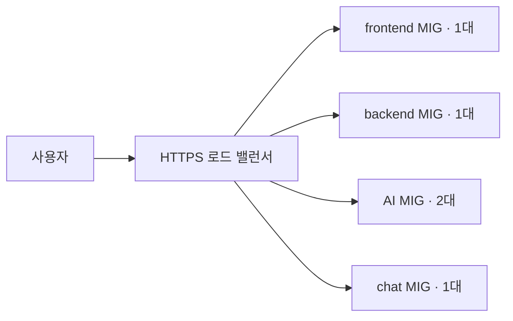

# 환경 공통 구성

[개발](dev/README.md) · [스테이징](staging/README.md) · [운영](prod/README.md) · [저장소 안내](../README.md)

## 환경 구분

| 항목 | 개발 | 스테이징 | 운영 |
| --- | --- | --- | --- |
| 기본 접두사 | `mulo-v2-dev` | `mulo-v2-staging` | `mulo-v2` |
| VPC | 기존 `default` 사용 | 전용 VPC 생성 | 별도 전용 VPC 생성 |
| VM 서브넷 | 기존 `default` 서브넷 | `10.21.0.0/24` | `10.20.0.0/24` |
| 앱 VM 주소 | 고정 공인·내부 IP | 내부 IP 자동 할당 | 내부 IP 자동 할당 |
| DB 접속 | 공인 IP와 TLS | 사설 IP | 사설 IP, 기존 DB는 TLS 유지 |
| 이미지 버킷 | 새 비공개 버킷 | 새 비공개 버킷 | 기존 버킷 사용 |
| Cloud Tasks | 없음 | AI 작업 큐 | 별도 AI 작업 큐 |
| LB 연결 드레이닝 | 해당 없음 | 60초 | 300초 |

같은 GCP 프로젝트를 사용하더라도 스테이징과 운영은 VPC·VM·로드 밸런서·큐를 각각 구성합니다. 스테이징은 DB와 버킷도 별도로 생성합니다. 프로젝트의 API 활성화와 할당량은 공유됩니다.

## 스테이징·운영의 요청 흐름

HTTP 요청은 HTTPS로 리다이렉트되고, HTTPS 요청은 아래 경로에 따라 서비스로 전달됩니다.

| 요청 경로 | 전달 대상 | 기본 포트 | 헬스체크 경로 |
| --- | --- | --- | --- |
| `/api`, `/api/*`, `/image`, `/image/*` | backend | 8080 | `/actuator/health` |
| `/ai/*`, `/internal/tasks/*` | AI | 8000 | `/health` |
| `/ws`, `/ws/*` | chat | 8081 | `/health` |
| 그 외 | frontend | 3000 | `/` |

로드 밸런서는 경로를 그대로 전달합니다. `/ai`와 `/internal/tasks`처럼 위 패턴에 없는 루트 경로는 frontend로 전달됩니다. [URL 맵 경로 규칙](https://docs.cloud.google.com/load-balancing/docs/url-map-concepts)에 따른 동작입니다. 도메인의 DNS A 레코드는 LB IP를 가리키며, 인증서는 Google 관리 인증서를 사용합니다.

## 데이터와 내부 통신

backend는 MySQL과 이미지 버킷, AI는 PostgreSQL, chat은 chat MySQL에 연결하는 구성입니다. 이미지 요청은 backend가 사용자 권한을 확인한 뒤 버킷의 객체를 읽거나 쓰도록 앱에서 구현합니다.

비동기 AI 작업은 **backend → Cloud Tasks → HTTPS LB → AI** 흐름입니다. Terraform은 큐와 OIDC용 서비스 계정을 만들고, backend 앱은 실제 처리 URL과 OIDC 설정을 넣어 작업을 등록합니다. AI 앱은 토큰을 검증합니다. `ai_task_target_url` 출력의 `/internal/tasks/*`는 경로 패턴이므로 실제 작업에는 앱의 구체적인 처리 URL을 사용합니다.

| 허용된 연결 | 포트 | 용도 |
| --- | --- | --- |
| LB → 앱 VM | 서비스별 포트 | 앱 요청과 헬스체크 |
| 앱 VM → Redis | 6379 | Redis 사용 |
| 모니터링 VM → 앱 VM | 서비스별 포트·9100 | 앱 지표와 Node Exporter 수집 |
| 앱 VM → 모니터링 VM | 3100 | Loki 로그 전송 |
| IAP → VM | 22 | SSH 접속 |

스테이징·운영 VM에는 공인 IP가 없고 외부 이미지 다운로드·API 호출은 Cloud NAT를 거칩니다. 모니터링과 Redis는 LB에 연결하지 않습니다. 위 방화벽은 통신 경로를 열어 주며, Redis·Prometheus·Loki·Node Exporter 실행과 설정은 직접 구성합니다.

## 앱 MIG의 동작

Terraform이 서비스별 인스턴스 템플릿을 만들고 MIG에 연결합니다. 템플릿 변경 시 새 VM을 먼저 1대 만들고, 헬스체크를 통과하면 기존 VM을 교체하는 롤링 정책을 사용합니다.

앱 VM은 교체 시 이름과 내부 IP가 바뀔 수 있습니다. 이전 VM에 직접 작성한 Compose 파일과 앱 설정은 새 VM에 자동으로 복사되지 않습니다. `service_container_images`도 이미지 주소를 VM 메타데이터에 기록할 뿐 앱을 실행하지는 않습니다.

앱의 HTTP 헬스체크 실패만으로 VM을 자동 재생성하지 않도록 설정되어 있습니다. VM 자체 장애로는 재생성될 수 있습니다. 모니터링·Redis VM의 부팅 디스크는 VM 삭제 후에도 남도록 설정되어 있습니다.

## 입력값·권한·상태

각 환경의 `variables.tf`는 입력 항목과 기본값, `main.tf`는 모듈에 전달하는 값, `outputs.tf`는 주소와 리소스 이름을 정의합니다. 실제 환경 값은 `terraform.tfvars`에 둡니다. 아래 환경별 문서의 사양은 코드 기본값 기준입니다.

backend의 버킷 객체 관리 권한과 모니터링 계정의 로그·지표 전송 권한은 Terraform이 부여합니다. 스테이징·운영 앱의 Artifact Registry 이미지 읽기 권한, backend의 큐 작업 등록 권한, backend·Cloud Tasks 서비스 에이전트의 OIDC 계정 사용 권한은 별도로 부여합니다. DB 사용자·비밀번호와 AI DB의 vector 확장도 직접 준비합니다.

Terraform 상태는 환경별로 따로 관리하며, 현재 원격 상태 저장소 선언은 없습니다. 상세 리소스는 [스테이징 모듈](../modules/staging_modules)과 [운영 모듈](../modules/prod_modules)에서 확인할 수 있습니다.
