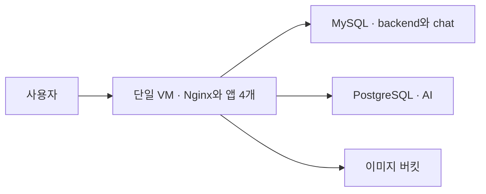

# 개발 환경

서비스를 한 VM에서 개발·검증하는 구성입니다. frontend·backend·AI·chat 컨테이너와 Nginx를 같은 VM에 배치하고, DB는 Cloud SQL을 사용합니다.

[환경 비교](../README.md) · [루트 모듈](main.tf) · [리소스 정의](../../modules/dev_modules)

## 리소스 구성

| 리소스 | 기본 구성 | 역할 |
| --- | --- | --- |
| 앱 VM | Ubuntu 22.04, `e2-standard-2`, 30GB | 서비스 4개와 Nginx 실행 환경 |
| MySQL | 8.4, `db-g1-small`, 20GB | `mulo`·`mulo_chat` DB |
| PostgreSQL | 18, `db-g1-small`, 20GB | AI용 `muro_ai` DB |
| GCS | 새 비공개 버킷 | 이미지 저장 |
| Cloud Tasks | 개발 전용 AI 큐 | 동시 1개·초당 1개 전달, 최대 5회 시도 |
| 네트워크 | 기존 `default` VPC·서브넷 | VM과 방화벽 배치 |

VM의 공인 IP와 내부 IP는 모두 예약된 고정 주소입니다. 서비스 계정에는 Artifact Registry 이미지 읽기, 로그·지표 전송, 이미지 버킷의 객체 관리 권한을 부여합니다.

개발 VM 서비스 계정에는 자기 자신에 대한 `roles/iam.serviceAccountTokenCreator`도 부여해 키 파일 없이 GCS 서명 URL을 생성합니다. 이 권한은 해당 서비스 계정에 직접 부여하며, 콘솔에서 먼저 부여한 권한은 [import 블록](imports.tf)으로 이 환경의 상태에 연결합니다.

## 요청과 데이터 흐름

DNS는 VM의 고정 공인 IP를 가리킵니다. 외부에 80·443 포트를 열어 두며, HTTPS 인증서와 Nginx의 서비스별 경로 분기는 앱 배포 시 직접 구성합니다.

Cloud SQL은 공인 IP를 사용합니다. 접속 허용 주소는 개발 VM의 고정 공인 IP `/32`이고, 연결에는 TLS를 요구합니다. DB 사용자와 앱 연결 정보는 직접 구성합니다.

## 환경 특성

별도 로드 밸런서·MIG·Redis VM·모니터링 VM을 생성하지 않습니다. 공통 초기 설정은 [bootstrap.sh](bootstrap.sh)가 담당합니다.

시작 스크립트는 최초 설정 완료 표식을 확인해 재부팅 시 설치를 건너뜁니다. 앱 Compose와 환경변수는 직접 구성하며, 일반적인 중지·시작에서는 디스크가 유지됩니다. VM과 부팅 디스크를 교체하면 앱 설정을 다시 준비해야 합니다.

개발 DB는 자동 백업·MySQL binlog·PostgreSQL PITR·디스크 자동 확장이 꺼져 있습니다. `runtime_enabled`는 개발 VM과 Cloud SQL의 실행 상태를 제어합니다.

## 개발 Cloud Tasks와 Nginx

큐 이름은 `mulo-v2-dev-ai-task`, 리전은 `asia-northeast3`입니다. 큐의 동시 전달 수와 초당 전달 수는 각각 1이고, 재시도는 운영과 같이 최대 5회 시도·5초~300초 backoff를 사용합니다.

개발 VM 서비스 계정에는 이 큐의 `roles/cloudtasks.enqueuer`와 개발 OIDC 계정에 대한 `roles/iam.serviceAccountUser`를 부여합니다. OIDC 계정은 `task_invoker_service_account` 출력으로 확인합니다. Cloud Tasks 서비스 에이전트의 기존 프로젝트 권한은 이번 설정에서 중복 관리하지 않습니다.

큐 IAM을 관리하는 Terraform 실행 계정에는 `cloudtasks.queues.getIamPolicy`와 `cloudtasks.queues.setIamPolicy` 권한이 필요합니다. 이번 적용에 사용한 사용자 계정의 임시 `roles/cloudtasks.admin` 역할은 검증 후 회수했습니다. 이후 계획·적용은 큐 IAM 조회·변경 권한이 있는 계정으로 실행해야 합니다.

요청 흐름은 **backend → Cloud Tasks → 개발 Nginx → AI**입니다. [default.conf](nginx/default.conf)의 `/internal/tasks/` 경로는 접두사를 유지해 `ai:8000`으로 전달하고, 읽기·쓰기 대기 시간은 300초입니다. 기존 `/internal`의 backend 전달과 `/ai/`의 접두사 제거 동작은 유지합니다. 실행 중인 VM의 파일은 `/home/runner/app/data/nginx/default.conf`입니다.

`ai_task_target_url`의 `*`는 라우팅 패턴입니다. 작업 등록 시에는 AI 앱에 구현한 실제 처리 경로로 바꿔야 합니다. 2026-10-19 확인한 개발 AI 이미지 `dev-1.18.0`에는 `/internal/tasks/*` 처리 경로가 없습니다. 이번 작업은 큐·IAM·Nginx 준비까지이며, backend의 작업 등록과 AI의 작업 처리·OIDC 토큰 검증은 앱 담당자가 연결합니다. Nginx가 OIDC 토큰을 직접 검증하지는 않습니다.

`runtime_enabled`를 꺼도 큐는 자동으로 일시 중지되지 않습니다. 개발 VM 중지 전에는 작업 등록을 멈추고 큐의 대기 작업을 확인해야 합니다.

## 주요 출력값

| 출력 | 내용 |
| --- | --- |
| `vm_public_ip`, `vm_private_ip` | 개발 VM의 고정 주소 |
| `dns_a_record`, `site_url` | DNS 등록 정보와 서비스 URL |
| `mysql_public_ip`, `postgres_public_ip` | DB 접속 주소 |
| `image_bucket_name`, `vm_service_account` | 이미지 버킷과 VM 서비스 계정 |
| `ai_tasks_queue_id` | 개발 Cloud Tasks 큐의 전체 리소스 이름 |
| `task_invoker_service_account` | HTTP 작업의 OIDC 신원 |
| `ai_task_target_url` | AI 작업 요청의 외부 URL 패턴 |
