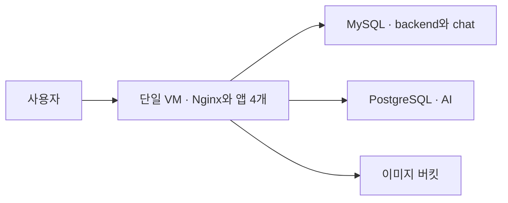

# 개발 환경

서비스를 한 VM에서 개발·검증하는 구성입니다. frontend·backend·AI·chat 컨테이너와 Nginx를 같은 VM에 배치하고, DB는 Cloud SQL을 사용합니다.

[환경 비교](../README.md) · [루트 모듈](main.tf) · [리소스 정의](../../modules/dev_modules)

## 리소스 구성

| 리소스 | 기본 구성 | 역할 |
| --- | --- | --- |
| 앱 VM | Ubuntu 22.04, `e2-medium`, 30GB | 서비스 4개와 Nginx 실행 환경 |
| MySQL | 8.4, `db-g1-small`, 20GB | `mulo`·`mulo_chat` DB |
| PostgreSQL | 18, `db-g1-small`, 20GB | AI용 `muro_ai` DB |
| GCS | 새 비공개 버킷 | 이미지 저장 |
| 네트워크 | 기존 `default` VPC·서브넷 | VM과 방화벽 배치 |

VM의 공인 IP와 내부 IP는 모두 예약된 고정 주소입니다. 서비스 계정에는 Artifact Registry 이미지 읽기, 로그·지표 전송, 이미지 버킷의 객체 관리 권한을 부여합니다.

## 요청과 데이터 흐름

DNS는 VM의 고정 공인 IP를 가리킵니다. 외부에 80·443 포트를 열어 두며, HTTPS 인증서와 Nginx의 서비스별 경로 분기는 앱 배포 시 직접 구성합니다.

Cloud SQL은 공인 IP를 사용합니다. 접속 허용 주소는 개발 VM의 고정 공인 IP `/32`이고, 연결에는 TLS를 요구합니다. DB 사용자와 앱 연결 정보는 직접 구성합니다.

## 환경 특성

별도 로드 밸런서·MIG·Cloud Tasks·Redis VM·모니터링 VM을 생성하지 않습니다. 공통 초기 설정은 [bootstrap.sh](bootstrap.sh)가 담당합니다.

시작 스크립트는 최초 설정 완료 표식을 확인해 재부팅 시 설치를 건너뜁니다. 앱 Compose와 환경변수는 직접 구성하며, 일반적인 중지·시작에서는 디스크가 유지됩니다. VM과 부팅 디스크를 교체하면 앱 설정을 다시 준비해야 합니다.

개발 DB는 자동 백업·MySQL binlog·PostgreSQL PITR·디스크 자동 확장이 꺼져 있습니다. `runtime_enabled`는 개발 VM과 Cloud SQL의 실행 상태를 제어합니다.

## 주요 출력값

| 출력 | 내용 |
| --- | --- |
| `vm_public_ip`, `vm_private_ip` | 개발 VM의 고정 주소 |
| `dns_a_record`, `site_url` | DNS 등록 정보와 서비스 URL |
| `mysql_public_ip`, `postgres_public_ip` | DB 접속 주소 |
| `image_bucket_name`, `vm_service_account` | 이미지 버킷과 VM 서비스 계정 |
